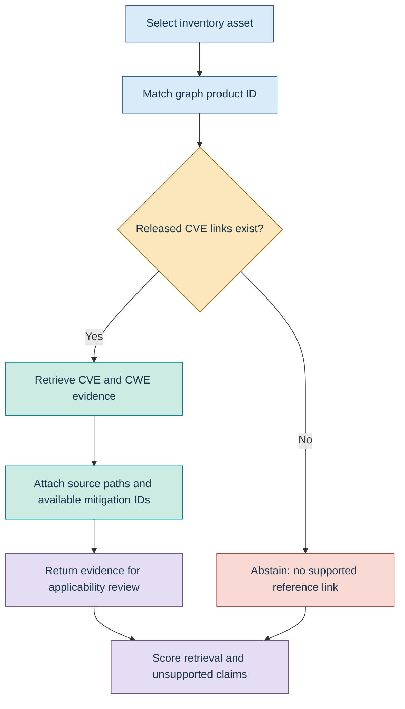
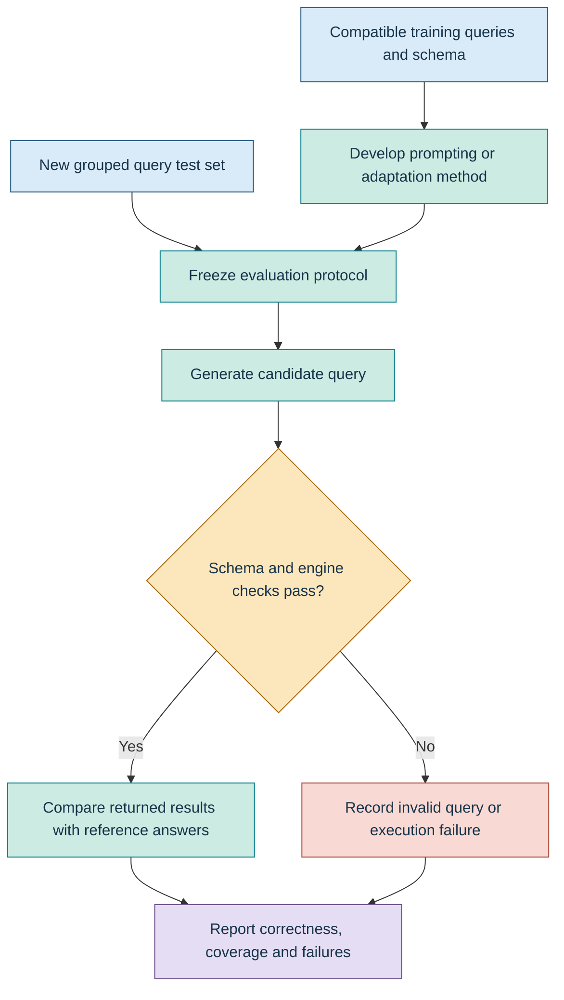
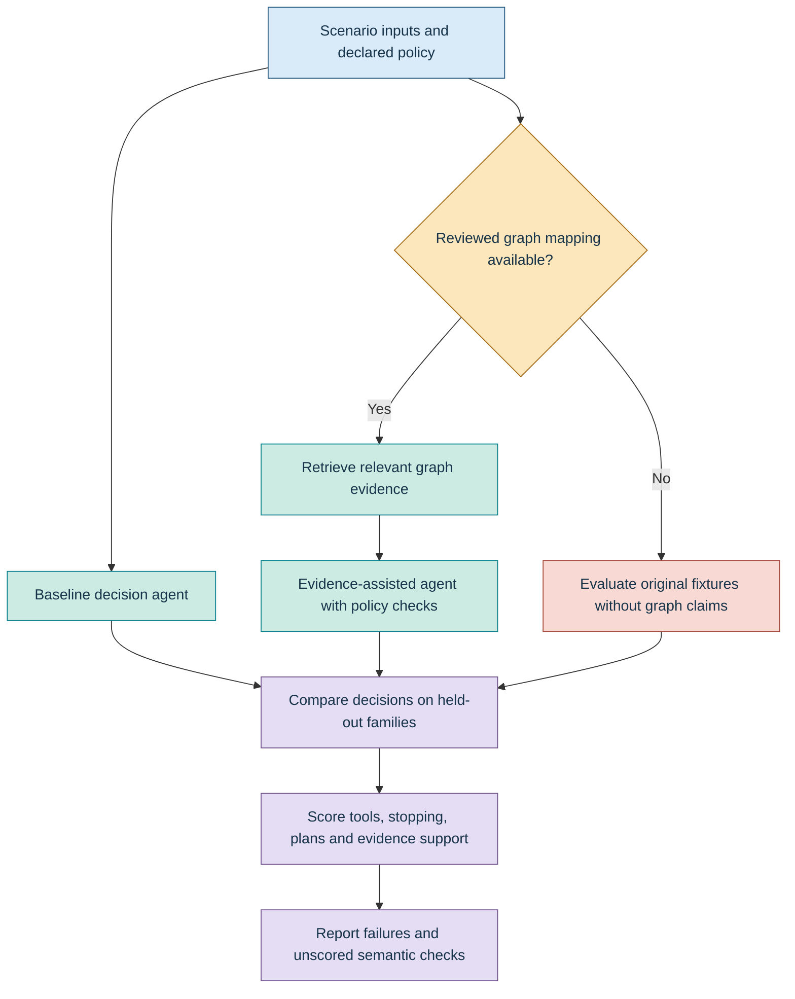
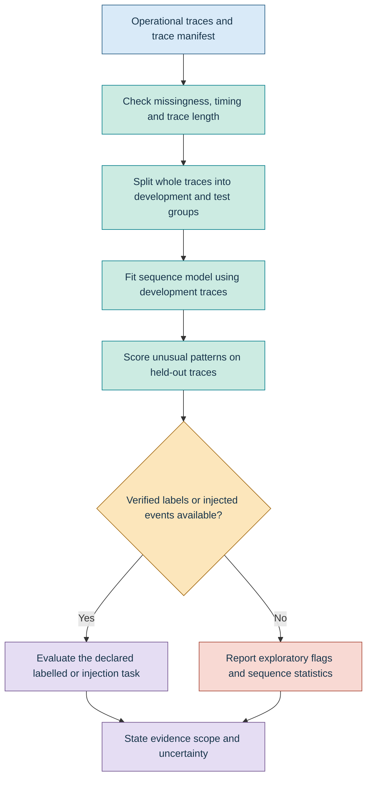

# Cybersecurity research with the datasets

These seven dataset families can support **independent studies** or **combined research pipelines** involving industrial cyber-physical systems, digital twins, knowledge graphs and AI. Some combinations have verified identifier joins; others require additional mappings or separately collected evidence.

The tables describe research uses, not experiments already completed. Read each folder's README for file details, source attribution and limitations. See the [Researcher's Guide](../RESEARCHERS_GUIDE.pdf) for the wider research agenda.

## 1. Using each dataset independently

| Dataset | Released contents | Suitable research and example experiment | Evaluation and limits |
|---|---|---|---|
| [Inventory](inventory/README.md) | 94 assets, 53 component records, 120 flows, 6 zones and 5 conduits | Attack-surface modelling, segmentation and monitoring placement. Compare topology-only priorities with priorities incorporating asset criticality and safety impact. | Critical-asset coverage, cross-zone reachability and placement cost. Inventory relationships do not establish measured security effectiveness. |
| [Knowledge graph](knowledge_graph/README.md) | 305,167 typed nodes and 276,420 declared edge rows | Threat reasoning, vulnerability mapping, graph completion and explainable retrieval. Withhold selected CVE–CWE associations and compare recovery methods. | Hits@k, MRR, reference agreement and evidence-path validity. Remove target/inverse relations from model inputs; endpoint validity is not semantic truth. |
| [Synthetic](synthetic/README.md) | 340 attackability rows and 9,880 protocol-log records | Protocol-aware analytics and modelled-risk sensitivity. Compare shared versus protocol-specific methods, or vary control-strength assumptions. | Ranking stability, sensitivity and performance on separately documented injected anomalies. Synthetic scores are not measured attack likelihood or physical impact. |
| [Benchmarks](benchmarks/README.md) | 2,047 adapted CTIBench reference tasks | LLM-based ATT&CK technique extraction and vulnerability-to-weakness mapping. Compare models, prompts and retrieval conditions. | Accuracy, precision/recall/F1, invalid identifiers and abstention. Labels are upstream references; preserve attribution and component licensing. |
| [Training](training/README.md) | 66 normalized release-compatible queries; 358 preserved legacy pairs | Cybersecurity query generation and model adaptation. Compare a base model with an adapted model on new query questions. | Schema compatibility, returned-result correctness and separately authored test performance. The compatible set uses a restricted grammar; legacy examples must not be executed indiscriminately. |
| [Operational](operational/README.md) | 14,124 event-feature records across 27 traces | Event-sequence modelling, temporal consistency and exploratory anomaly analysis. Learn transitions from complete training traces and examine held-out traces. | Sequence likelihood, flag rate, missingness and transition violations. Signal units and attack labels are unavailable; `ok` is not an attack label. |
| [Agent scenarios](agent_scenarios/README.md) | 400 expected-decision cases across 20 scenario families | Planning, tool selection, stopping rules and policy compliance. Compare model-only decisions with policy-constrained decisions. | Decision agreement, invalid-tool rate, termination compliance and plan completeness. Fixtures are expected decisions, not observed attacks or executed model outcomes. |

**Evidence classes must remain explicit:** source-derived references, synthetic assumptions, operational observations and expected decisions are different forms of evidence. A method can be evaluated on one family without loading every other family.

## 2. Combining datasets

Combine records through declared relationships and task interfaces. Do not concatenate all seven families into a single flat training table.

| Combination | Research enabled | How to combine | Current suitability |
|---|---|---|---|
| **Inventory + knowledge graph** | Asset-contextual threat reasoning and vulnerability-reference retrieval | Join inventory `asset_id` to graph `product_id`, then traverse supported relations. | **Verified identity join:** 94/94 inventory assets match graph products. Source associations still require applicability review. |
| **Inventory + synthetic** | Communication-aware, modelled risk analysis | Validate flow and endpoint identities, then attach synthetic attributes to the relevant structural relationships. | Conditional on file-specific coverage and provenance. Alternative attackability views are not independent samples. |
| **Knowledge graph + benchmarks** | Graph-assisted CTI evaluation | Retrieve relevant graph evidence for each question and compare answers with and without that evidence. | Feasible where evidence exists. Audit answer leakage and report unavailable evidence rather than inventing it. |
| **Training + knowledge graph** | Natural-language-to-query systems | Generate queries using the declared schema, execute them against an appropriately imported graph and inspect the results. | Use the compatible subset and [import schema](../metadata/graph_import_schema.json). Source-table validation has been performed; full Neo4j engine validation remains separate. |
| **Training + benchmarks** | Downstream evaluation of an adapted cybersecurity model | Adapt on training material and evaluate separately on CTI tasks. | Query generation and CTI reasoning are different tasks. CTI scores alone do not validate query correctness; audit overlap and prompt tuning. |
| **Knowledge graph + agent scenarios** | Evidence-grounded agent decisions | Supply graph evidence through documented entity mappings, then evaluate decisions and constraints. | **Conditional:** scenario target names have no verified inventory/graph crosswalk. New mappings and semantic expectations need review. |
| **Operational + inventory/graph** | Contextual interpretation of unusual events | Map each signal to equipment, quantities and graph entities before interpreting anomalies. | **Not directly supported yet:** the released signal-to-equipment and units mappings are missing. |
| **Synthetic + operational** | Comparison across generated and observed data | Establish common feature meanings and evaluate the same analytical method separately on each family. | Conditional. Similar column names or numerical values do not establish comparable physical meaning. |

### Verified joins and remaining gaps

- **Inventory assets → graph products:** 94/94 distinct asset IDs match.
- **Dataflow endpoints → inventory assets and graph products:** 79/79 distinct endpoint IDs match each namespace.
- **Inventory assets → graph hosts:** no direct match; host nodes are a separate namespace. Use the product crosswalk for the verified asset join.
- **Component inventory → graph component `machine_id`:** no direct match under the tested keys; do not infer equivalence from the shared record count.
- **Operational signals → equipment** and **agent target names → inventory pseudonyms:** no verified released crosswalk.

See the [join-coverage report](../reports/join_coverage.json), [asset crosswalk](../metadata/asset_graph_crosswalk.csv), [connectivity report](../reports/graph_connectivity.json) and [typed relation rules](../metadata/graph_relation_rules.json). An identity match supports a declared join, not confirmation that an asset is exploitable.

## 3. Workflow A: asset-aware threat-evidence retrieval

**Use:** inventory + knowledge graph. This is the strongest immediately available connected task.

The [implemented connected task](../evaluation/README.md#connected-task-and-independent-review) covers **94 assets**, including **33 with released CVE links** and **86 asset–CVE edges**. Retrieve source-linked identifiers, preserve evidence paths and abstain where links are missing. An absent link does not establish absence of vulnerability. Identifier-only mitigation nodes do not justify an operational recommendation, and retrieval does not authorize an action.

## 4. Workflow B: reliable cybersecurity query generation

**Use:** training + knowledge graph, with a separately authored query test set. CTI benchmarks can add a distinct downstream evaluation.

Use [`release_compatible.json`](training/release_compatible.json) for the minimized public schema. Keep related identifiers and query templates together when splitting data. Do not supply `expected_ids` to the model. The 66 queries have restricted-grammar and source-table validation; **Neo4j engine checks and independent query-test construction are further experimental steps**, not completed results implied by this flowchart. Adaptation and live-model evaluation also require actual execution.

## 5. Workflow C: governed, evidence-grounded agent reasoning

**Use:** agent scenarios independently; add knowledge-graph evidence only through verified mappings. The integrated workflow below is a proposed research protocol.

The [agent evaluator](../evaluation/README.md#agent-output-contract) accounts for all 400 fixtures. Assertions needing reviewed topology or technique/target context remain explicitly unscored when that context is unavailable. Keep scenario families together; variations of one rule are not automatically independent observations. Use the [local-model runner](../evaluation/README.md#real-local-model-comparisons) to generate real predictions. The reference results describe deterministic experiments; use the runner to produce model-specific measurements. No attack tool or physical action is executed by this evaluation suite.

## 6. Workflow D: exploratory event-sequence analysis

**Use:** operational traces independently. Contextual equipment interpretation is a separate extension requiring additional metadata.

Start with the [trace manifest](../metadata/trace_manifest.csv) and [operational semantics](../metadata/operational_semantics.json). Event spacing is not a verified uniform sensor-sampling interval. Short traces need explicit eligibility rules. Unusual transitions are not automatically cyberattacks. Injected events evaluate the injection protocol; they do not retrospectively label the original observations as malicious.

## 7. Experiment design, attribution and reuse

1. **Define the claim and evaluation unit.** Distinguish asset, graph entity, flow, query, benchmark description, complete trace and scenario family.
2. **Choose only the required families.** Establish identity and semantic compatibility before combining records.
3. **Prevent leakage.** Group related descriptions, identifiers, templates and traces; remove target/inverse relations for graph completion. Use [benchmark description groups](../metadata/benchmark_split_groups.csv) where applicable.
4. **Retain provenance and uncertainty.** Report source-derived associations, synthetic assumptions, observations and expected decisions separately. Do not invent physical semantics or missing mappings.
5. **Report comparable baselines and failures.** Keep retrieval quality, query correctness, decision compliance and physical applicability as separate outcomes.
6. **Respect component licenses.** The adapted CTIBench folder retains [CC BY-NC-SA 4.0](benchmarks/LICENSE). Consult the [license map](../metadata/licenses.csv) and [third-party notices](../THIRD_PARTY_NOTICES.md).

The [related publications](../docs/RELATED_PUBLICATIONS.md) distinguish co-authored research from external sources such as CTIBench. BRIDG-ICS and NeuroGraph inform graph/reasoning research; HySecTwin informs digital-twin and semantic-monitoring studies; the trusted-autonomy and behavioural-agent work inform decision evaluation. These connections do not establish that every article's experiments can be reproduced from this public subset.

**Further documentation:** [Dataset card](../docs/DATASET_CARD.md) · [Schemas](../docs/SCHEMAS.md) · [Curation methods](../docs/METHODS.md) · [Validation](../docs/VALIDATION.md) · [File-level research map](../metadata/research_file_map.csv) · [Research methods](../docs/RESEARCH_METHODS.md) · [Runnable starters](../examples/README.md).
